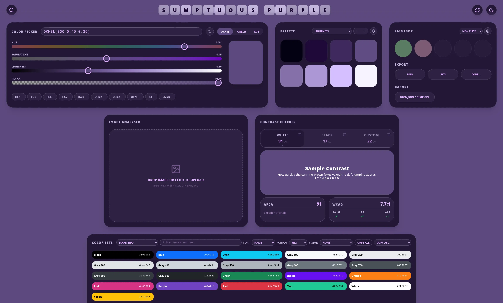

# Color Picker Palette

A color picker with palette generator, image analyser, contrast checker, color set browser, and export options. Author in Okhsl (default, gamut-aware), Oklch (wide gamut), or RGB, then copy or export to whichever format you need.

Visit [Color Picker Palette](https://dcog989.github.io/Color-Picker-Palette/).

## Features

- **Perceptual Pickers:** Okhsl (default, gamut-aware), Oklch (wide gamut), or RGB, with nearest-sRGB mapping for out-of-gamut colors.
- **Palette Engine:** Six harmonies (complementary, split-complementary, analogous, triadic, tetradic, rectangle) and variable scales on lightness, chroma, hue, or alpha.
- **Image Analysis:** Extract dominant and vibrant palettes locally with histogram clustering; sort by dominant, vibrant, bright, or dark.
- **Accessibility:** Real-time APCA (Lc) and WCAG 2.1 contrast checking.
- **Smart Paintbox:** Persistent palette, import from DTCG JSON or GIMP `.gpl`, export to CSS, Tailwind, SCSS, Less, JSON, CSV, DTCG, Android XML, GPL, or text in Oklch/HEX/HSL/RGB, plus PNG and SVG images.
- **Library:** Search 30,000+ named colors.
- **Color Sets:** Browse 24 curated palettes (Tailwind, Material, Pantone, Catppuccin, Nord, and more), filter and sort them, copy any swatch or the whole set in any export format, and simulate color-vision deficiencies.
- **Shareable:** The current color mirrors to the URL hash, so any color is linkable.
- **Themes:** Light and dark, persisted.

## Tech Stack

- Svelte / TypeScript / Tailwind / Vite / Biome
- **Color:** colordx

## Getting Started

Required: [bun](https://bun.sh).

| Command                 | Action                                                      |
| ----------------------- | ----------------------------------------------------------- |
| `bun install`           | Install dependencies (also installs git hooks via Lefthook) |
| `bun run dev`           | Start dev server at <http://localhost:5173>                 |
| `bun run build`         | Production build to `dist/`                                 |
| `bun run preview`       | Preview build                                               |
| `bun run check`         | All checks: Biome + typecheck + test with coverage + build  |
| `bun run typecheck`     | svelte-check + `bun --check`                                |
| `bun run test`          | Run tests                                                   |
| `bun run test:coverage` | Tests with coverage (80% floor)                             |
| `bun run fix`           | All fixes: Biome auto-fix (format/lint/imports)             |
| `bun run changelog`     | Print the changelog to stdout                               |

## Releasing

1. Commit with [Conventional Commits](https://www.conventionalcommits.org/); Lefthook and CI enforce the format.
2. Run `bun run release` (`cog bump --auto`).
3. The bump runs `bun run check`, syncs the version, commits and tags, pushes, then creates the GitHub release with the tag's changelog section as notes and `CHANGELOG.md` attached as an asset.

Requires `cog` and an authenticated `gh`. `main` deploys to GitHub Pages once CI passes.

## License

[MIT License](LICENSE).
